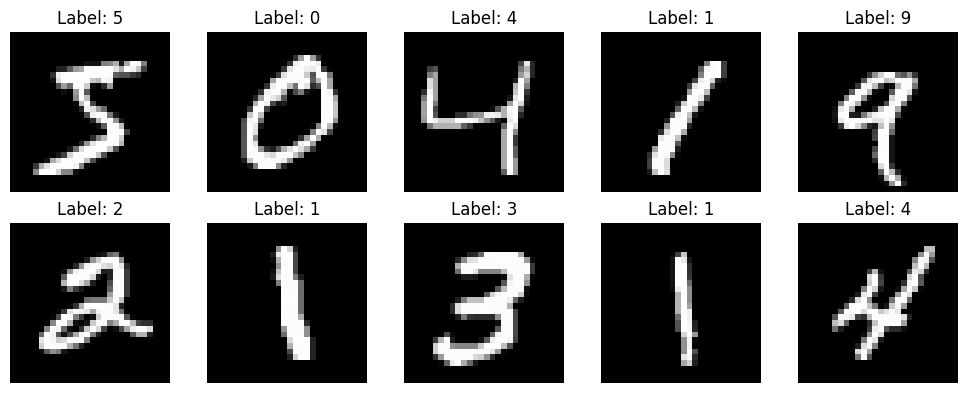
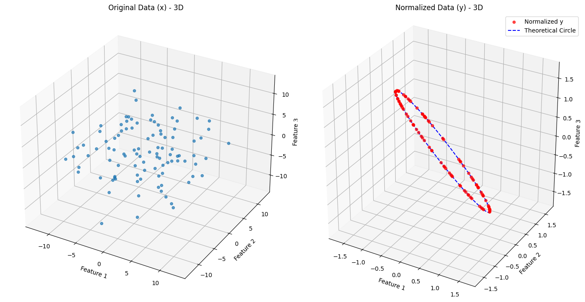
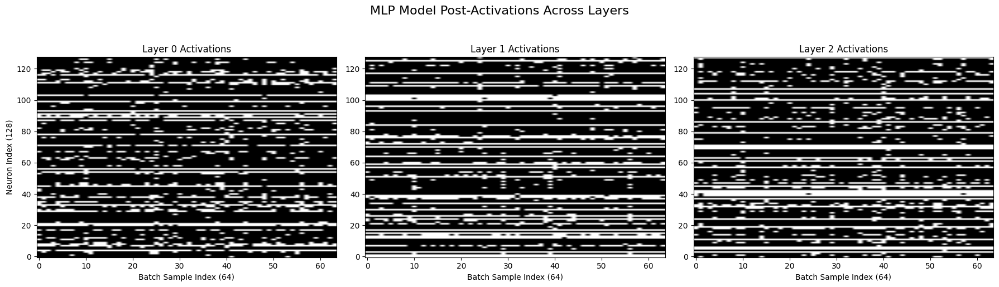
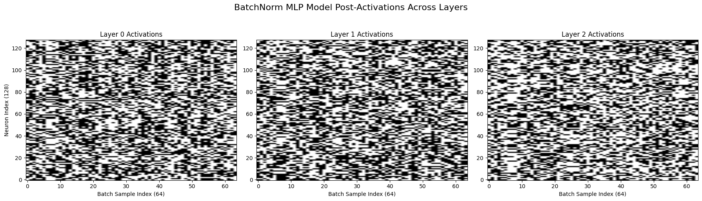
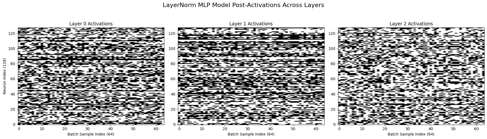
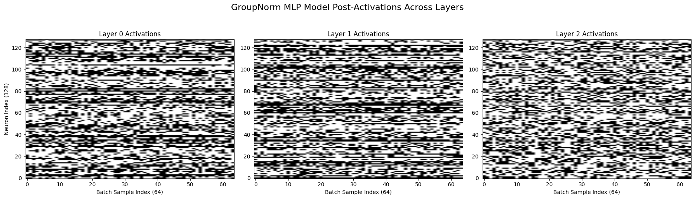
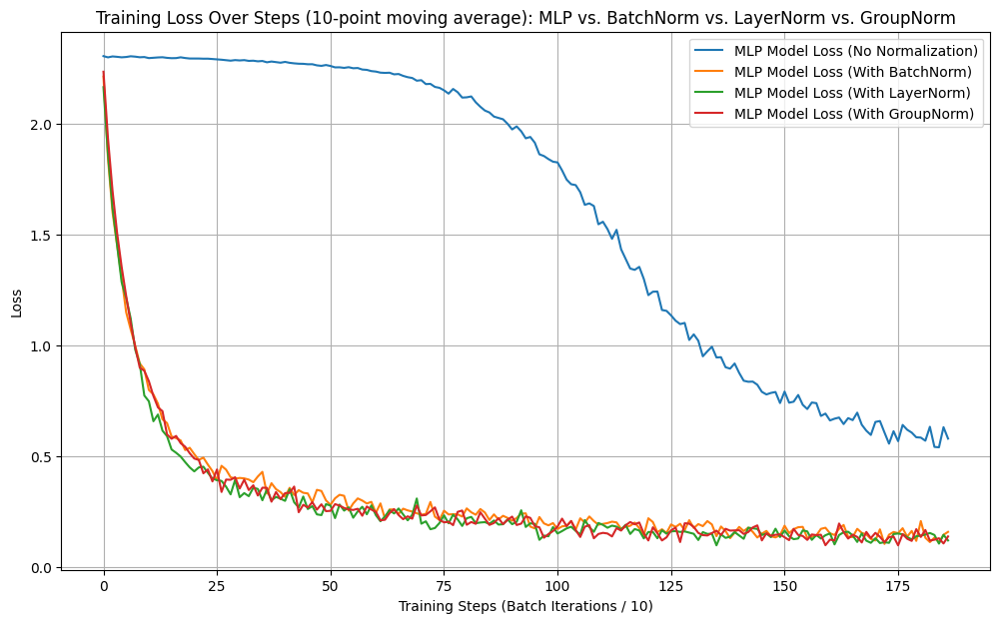



> The code below is trimmed to the essentials; the full, runnable version lives in the original notebook:
> [**github.com/litlig/notebooks/normalization.ipynb**](https://github.com/litlig/notebooks/blob/main/normalization.ipynb)
>
> <a href="https://colab.research.google.com/github/litlig/notebooks/blob/main/normalization.ipynb" target="_parent"></a>

Normalization is a ubiquitous part of modern transformer architectures. I frequently see different normalization algorithms (BatchNorm, LayerNorm) in neural net definitions. Even though I know it's there to improve training performance and avoid issues like covariate shift and non-linearity saturation, I always wondered: what are the assumptions behind these different approaches? How can such a transformation not lose input information? And what scenarios call for one approach over another?

Here I wrote a from-scratch implementation of the three — batch norm, layer norm, and group norm — applied them to a simple MLP on the MNIST dataset, and discuss the underlying assumptions as I understand them.

## Set up

We use a basic fully-connected neural network to classify digits from MNIST:

- **Input:** 28×28 image, flattened to 784 features.
- **Hidden layers:** 3 fully-connected layers, each with 128 activations and ReLU non-linearity.
- **Output layer:** fully-connected layer with 10 activations (one per class) and softmax for classification.
- **Loss:** categorical cross-entropy.



The layer and network are kept generic so we can swap in a normalized layer type without touching the rest of the code:

```python
class MLPLayer(nn.Module):
  def __init__(self, input_dim, hidden_dim, activation):
    super().__init__()
    self.linear = nn.Linear(input_dim, hidden_dim)
    self.activation = activation()

  def forward(self, x):
    return self.activation(self.linear(x))


class SimpleNN(nn.Module):
  def __init__(self, n_layer, layerNN, activationNN=nn.ReLU):
    super().__init__()
    self.flatten = nn.Flatten()
    self.mlp = nn.Sequential()
    self.mlp.append(layerNN(input_dim, dim_hidden, activationNN))
    for _ in range(n_layer - 1):
      self.mlp.append(layerNN(dim_hidden, dim_hidden, activationNN))
    self.mlp.append(nn.Linear(dim_hidden, 10))

  def forward(self, x):
    return self.mlp(self.flatten(x))
```

## Batch normalization

[Reference paper](https://arxiv.org/pdf/1502.03167)

Deep NN training often runs into a problem called covariate shift together with non-linearity saturation. During training, the covariates passed to the non-linear activation function can drift into the saturation regime, leading to vanishing gradients and slow training.

Batch normalization brings the covariates back to a favorable domain by shifting and scaling:

\[\widehat{x} = \frac{x - \mu}{\sigma}\]

where \(\mu\) is the mean and \(\sigma\) is the standard deviation over the mini-batch.

In neural nets there is always a linear layer aggregating information across the hidden dimension before it is fed to the activation, \(z = Wx + b\). Scaling and shifting \(x\) does not lose information, because it can be absorbed by \(W\) and \(b\). However, the net adjusts \(W\) and \(b\) by gradient descent for the task; stabilizing the covariate distribution is not part of its objective, and this often leads to poor training performance. Batch norm keeps the covariate statistics stable by construction. To restore the scale and shift that the net actually needs, it introduces trainable parameters, so the input to the activation becomes \(\gamma \widehat{x} + \beta\).

Note that batch norm assumes the mini-batch statistics represent the overall population fairly well, so it often performs poorly when the batch size is too small.

```python
class BatchNormMLP(nn.Module):
  def forward(self, x):
    x = self.linear(x)  # B, hidden_dim
    if self.training:
      mean = x.mean(dim=0)                    # over the batch
      var = x.var(dim=0, unbiased=False)
      # update running stats for eval time ...
      x = (x - mean) / torch.sqrt(var + eps)
    else:
      x = (x - self.running_mean) / torch.sqrt(self.running_var + eps)
    x = x * self.gamma + self.beta
    return self.activation(x)
```

## Layer normalization

Batch norm normalizes across batch samples for each neuron in a layer; layer norm instead treats each sample individually and normalizes across all neurons for that sample:

\[\widehat{x_i} = \frac{x_i - \mu_i}{\sigma_i}\]

Here \(x_i\) is a sample vector with \(d\) dimensions. For each sample it:

1. projects \(x\) onto the \((d-1)\)-dimensional subspace where \(\sum_j x_{ij} = 0\);
2. divides by \(\sigma\) to fix the norm to 1.

Unlike batch norm, the layer norm transformation is not fully recoverable by a linear transformation nor by the affine step. It reduces the feature dimension by 2: as the example below shows, the 3-D \(x\) is now confined to a circle.



Layer norm assumes that the (centered) direction of a sample carries the information, and that the mean and scale are redundant. That is a genuine inductive bias, but in practice it is often a good bet.

```python
class LayerNormMLP(nn.Module):
  def forward(self, x):
    x = self.linear(x)                          # B, hidden_dim
    mean = x.mean(dim=1, keepdim=True)          # over features, per sample
    var = x.var(dim=1, unbiased=False, keepdim=True)
    x = (x - mean) / torch.sqrt(var + eps)
    x = x * self.gamma + self.beta
    return self.activation(x)
```

## Group normalization

Group norm takes a step further from layer norm: instead of normalizing across all features in a layer, it splits the features into groups and normalizes each group by its own mean and standard deviation. The idea is that different groups can have genuinely different statistics, so they should not be pooled together when computing the mean and variance.

Group norm further reduces the degrees of freedom to \(d - 2g\), where \(d\) is the total feature dimension and \(g\) is the number of groups, in exchange for not letting heterogeneous groups pollute each other's statistics. It was introduced for vision models with small batch sizes: channel groups (e.g. from grouped convolutions, or filters tuned to different frequencies or orientations) can have genuinely different natural scales, and pooling all of them into one LayerNorm-style mean/variance would wash out that structure.

```python
class GroupNormMLP(nn.Module):
  def forward(self, x):
    B = x.shape[0]
    x = self.linear(x).view(B, self.n_group, self.hidden_dim // self.n_group)
    mean = x.mean(dim=2, keepdim=True)          # within each group
    var = x.var(dim=2, unbiased=False, keepdim=True)
    x = (x - mean) / torch.sqrt(var + eps)
    x = x.view(B, self.hidden_dim)
    x = x * self.gamma + self.beta
    return self.activation(x)
```

## Results across all models

We compare the four models — one vanilla MLP and three MLPs with different normalizations — on training speed, test-set accuracy, and neuron activation.

For neuron activation, the big white chunks for the vanilla MLP mean there are neurons that never activate for any sample in the batch. With normalization the chart shows a more mixed black-and-white texture: each neuron fires for some samples and not others, so its output is actually input-dependent — which is what we want if the network is going to use that neuron to help separate digit classes.









All three normalized models train faster and reach better accuracy than the vanilla MLP, but there is no significant difference in training speed among themselves:



| Model | Test accuracy (%) |
|---|---|
| MLP | 84.09 |
| BatchNorm MLP | 96.58 |
| LayerNorm MLP | 95.37 |
| GroupNorm MLP | 96.33 |

There is no significant difference among the three normalizations here because the example is simple enough that all of them perform well. There is no convolutional layer for feature extraction, so group norm has no advantage over layer norm in this setting.
