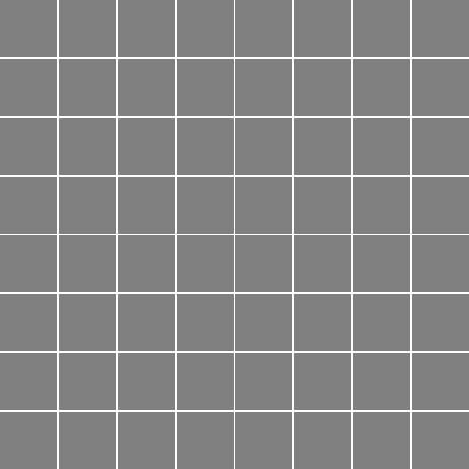



> The code below is trimmed to the essentials; the full version lives in the original notebook:
> [**github.com/litlig/notebooks/pixel_art_discrete_diffusion.ipynb**](https://github.com/litlig/notebooks/blob/main/pixel_art_discrete_diffusion.ipynb)
>
> Follow-up to [Language generation with discrete diffusion]().
>
> <a href="https://colab.research.google.com/github/litlig/notebooks/blob/main/pixel_art_discrete_diffusion.ipynb" target="_parent"></a>



Diffusion models are widely used to generate images. Pixel art, with limited data points and a categorical palette, can be a good fit for discrete diffusion.

The [dataset](https://www.kaggle.com/datasets/litlig/palette-pixel-art) contains 16x16 images in 5 categories. What each category means is not explicitly stated, just inferring from the dataset, the first and the last seems to be front facing and side facing of characters, while the other three are less obvious. To simplify, we just use the first one, hopefully to train a model to generate front facing characters by de-masking pixels step by step.


### Training

The goal to learn a process to convert fully noised/masked image to a front-facing character pixel art. If we know the ending pixel art, we can design a process like this: at each time step, a masked pixel can decide either stay masked or jump to the ending color, an un-masked pixel always stays in the ending color. The cumulative probability of jump from 0 to t is \(\alpha_t\), and it satisfies \(\alpha_0 = 0\) and \(\alpha_1 = 1\). This \(\alpha_t\) is called denoise schedule.

When the ending pixel art is not given, the denoise schedule is still \(\alpha_t\), but the ending color to jump to is unknown. The best guess we make here is the most likely ending state given the current partially noised image and time t. We build a multi-head transformer to predict the ending state, the model can be further simplified to skip t as the input as the time information is already embedded in the number of masked pixels.

```python
img_size = 16
p_mask = 256
n_vocab = 257
n_seq = img_size * img_size

class Net(nn.Module):
  def __init__(self):
    super(Net, self).__init__()
    self.emb = nn.Embedding(n_vocab, dim)
    self.pos_emb = nn.Embedding(n_seq, dim)
    self.blocks = nn.Sequential(*[Block(head_size=dim // n_head) for _ in range(n_layer)])
    self.proj = nn.Linear(dim, n_vocab-1)

  def forward(self, x): # x, B:n_seq
    x = self.emb(x) + self.pos_emb(torch.arange(n_seq, device=device)) # B:n_seq:dim
    x = self.blocks(x)
    return self.proj(x) # B:n_seq:n_vocab-1
```

```python
t = torch.rand(batch_size, device=device)
kappa = torch.bernoulli(t.view(batch_size,1,1).expand(batch_size, img_size, img_size)).long().to(device)
masked_pos = (kappa == 0)
xt = p_mask * (1-kappa) + images * kappa
z = model(xt.view(batch_size,-1))
loss = F.cross_entropy(z.view(-1, n_vocab-1)[masked_pos.view(-1)], images.view(-1)[masked_pos.view(-1)])
```


### Sampling

```python
x = p_mask * torch.ones((n_sample, img_size, img_size), device=device).long()
alpha_prev = 0
for step in range(steps):
  alpha_curr = step/steps
  alpha_t = ((alpha_curr - alpha_prev)/(1-alpha_prev)) * torch.ones(n_sample, device=device)
  kappa = torch.bernoulli(alpha_t.view(n_sample,1,1).expand(n_sample, img_size, img_size)).long().to(device)
  kappa = kappa * (x == p_mask).long()
  logits = model(x.view(n_sample, -1))
  sample = torch.multinomial(F.softmax(logits, dim=-1).view(n_sample * img_size * img_size, -1), num_samples=1).view(n_sample, img_size, img_size)
  x = sample.view(n_sample, img_size, img_size) * kappa + x * (1-kappa)
  alpha_prev = alpha_curr
```
