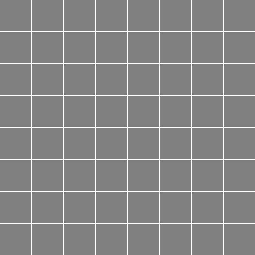
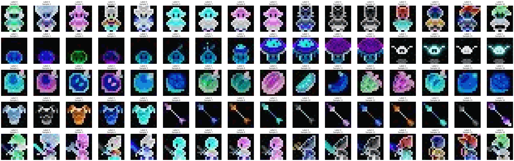
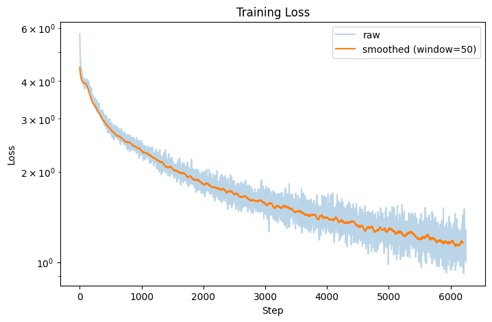



> The code below is trimmed to the essentials; the full version lives in the original notebook:
> [**github.com/litlig/notebooks/pixel_art_discrete_diffusion.ipynb**](https://github.com/litlig/notebooks/blob/main/pixel_art_discrete_diffusion.ipynb)
>
> Follow-up to [Language generation with discrete diffusion]().
>
> <a href="https://colab.research.google.com/github/litlig/notebooks/blob/main/pixel_art_discrete_diffusion.ipynb" target="_parent"></a>



Diffusion models are widely used to generate images. Pixel art, with limited data points and a categorical palette, can be a good fit for discrete diffusion.

The [dataset](https://www.kaggle.com/datasets/litlig/palette-pixel-art) contains 16x16 images in 5 categories. What each category means is not explicitly stated, just inferring from the dataset, the first and the last seems to be front facing and side facing of characters, while the other three are less obvious. To simplify, we just use the first one, hopefully to train a model to generate front facing characters by de-masking pixels step by step.



### Training

The goal to learn a process to convert fully noised/masked image to a front-facing character pixel art. If we know the ending pixel art, we can design a process like this: at each time step, a masked pixel can decide either stay masked or jump to the ending color, an un-masked pixel always stays in the ending color. The cumulative probability of jump from 0 to t is \(\alpha_t\), and it satisfies \(\alpha_0 = 0\) and \(\alpha_1 = 1\). This \(\alpha_t\) is called denoise schedule.

When the ending pixel art is not given, the denoise schedule is still \(\alpha_t\), but the ending color to jump to is unknown. The best guess we make here is the most likely ending state given the current partially noised image and time t. We build a multi-head transformer to predict the ending state, the model can be further simplified to skip t as the input as the time information is already embedded in the number of masked pixels.

```python
img_size = 16
p_mask = 256
n_vocab = 257
n_seq = img_size * img_size

class Net(nn.Module):
  def __init__(self):
    super(Net, self).__init__()
    self.emb = nn.Embedding(n_vocab, dim)
    self.pos_emb = nn.Embedding(n_seq, dim)
    self.blocks = nn.Sequential(*[Block(head_size=dim // n_head) for _ in range(n_layer)])
    self.proj = nn.Linear(dim, n_vocab-1)

  def forward(self, x): # x, B:n_seq
    x = self.emb(x) + self.pos_emb(torch.arange(n_seq, device=device)) # B:n_seq:dim
    x = self.blocks(x)
    return self.proj(x) # B:n_seq:n_vocab-1
```

```python
t = torch.rand(batch_size, device=device)
kappa = torch.bernoulli(t.view(batch_size,1,1).expand(batch_size, img_size, img_size)).long().to(device)
masked_pos = (kappa == 0)
xt = p_mask * (1-kappa) + images * kappa
z = model(xt.view(batch_size,-1))
loss = F.cross_entropy(z.view(-1, n_vocab-1)[masked_pos.view(-1)], images.view(-1)[masked_pos.view(-1)])
```



### Sampling

Sampling starts from a fully masked image and reverses the process: at each step the model predicts the ending color for every masked pixel, and some of those pixels get un-masked. What differs between the approaches below is only how the pixels to un-mask are picked at each step. All of them un-mask the same number of pixels overall, 1000 steps, 64 samples.

#### Un-masking each pixel independently

This follows the training process literally. Each still-masked pixel flips on its own with the probability given by the denoise schedule, and gets the color sampled from the model's prediction for that position.

```python
x = p_mask * torch.ones((n_sample, img_size, img_size), device=device).long()
alpha_prev = 0
for step in range(steps):
  alpha_curr = step/steps
  alpha_t = ((alpha_curr - alpha_prev)/(1-alpha_prev)) * torch.ones(n_sample, device=device)
  kappa = torch.bernoulli(alpha_t.view(n_sample,1,1).expand(n_sample, img_size, img_size)).long().to(device)
  kappa = kappa * (x == p_mask).long()
  logits = model(x.view(n_sample, -1))
  sample = torch.multinomial(F.softmax(logits, dim=-1).view(n_sample * img_size * img_size, -1), num_samples=1).view(n_sample, img_size, img_size)
  x = sample.view(n_sample, img_size, img_size) * kappa + x * (1-kappa)
  alpha_prev = alpha_curr
```


The character shape comes out, but the colors are speckled. The pixels un-masked in the same step are drawn independently from their own marginals, so they don't agree with each other.

#### Confidence-based, most-sure positions first

Instead of letting each pixel decide on its own, sample a color for every masked position, then only commit the ones the model is most sure about, i.e. the highest probability of the sampled color. The number of positions to commit at each step, `k`, comes from the same schedule.

```python
still_masked = (x.view(n_sample, -1) == p_mask)
probs = F.softmax(model(x.view(n_sample, -1)), dim=-1)
sample = torch.multinomial(probs.view(-1, probs.shape[-1]), num_samples=1).view(n_sample, n_seq)
confidence = probs.gather(-1, sample.unsqueeze(-1)).squeeze(-1)

temperature = temperature_max * (1 - step / steps)  # anneal to 0 by the last step
noisy_confidence = torch.log(confidence.clamp(min=1e-20)) + temperature * sample_gumbel(confidence.shape, device)
noisy_confidence = noisy_confidence.masked_fill(~still_masked, float('-inf'))

target_after = round(((step + 1) / steps) * n_seq)
k = max(target_after - revealed_so_far, 0)
reveal = torch.zeros_like(still_masked)
if k > 0:
  reveal.scatter_(1, torch.topk(noisy_confidence, k, dim=1).indices, True)
x = torch.where(reveal, sample, x.view(n_sample, -1)).view(n_sample, img_size, img_size)
revealed_so_far = target_after
```

With `temperature_max = 0` the ranking is purely the confidence, so the committed pixels are always the safest ones.


Much cleaner sprites, but all 64 samples end up nearly the same character. Always taking the most confident positions pushes every sample towards the same high probability mode.

#### Confidence-based with annealed noise

To get the diversity back, the ranking is perturbed with Gumbel noise scaled by a temperature that anneals linearly to 0. Early steps pick positions almost at random, later steps go back to most-sure-first.


The samples are different from each other again, and still hold together better than the independent version.
